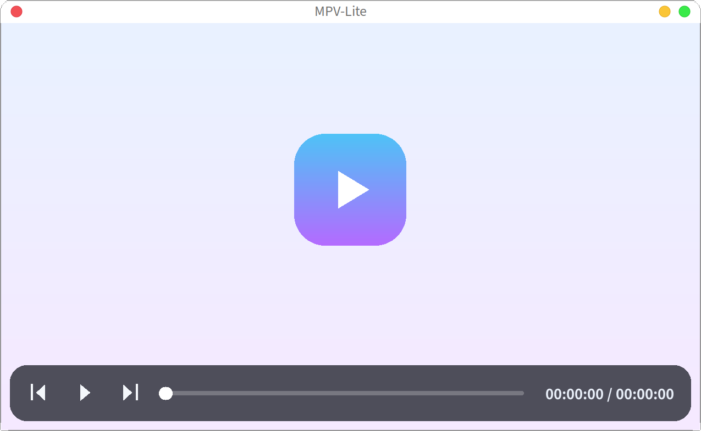

# MPV Lite

一款使用 C / SDL2 遍写的仿 MPV 界面的轻量级音视频播放器。

## 特性

- 支持常见音视频格式。
- 静态编译，体积小，不依赖 ffmpeg 等外部库。
- 界面清爽简单。

## 快捷键

- 按 `s` 键截取当前画面，保存在视频同目录，格式为 PNG。
- 按 `o` 键打开内置文件浏览器。
- 按 `q` 键退出 MPV Lite。

## 运行时

画面渲染和音频输出需要加载 X11 (libX11.so.6)、ALSA (libasound.so.2) 后端。

这两项在图形化的 Linux 系统上应该会默认安装。

## 截图

